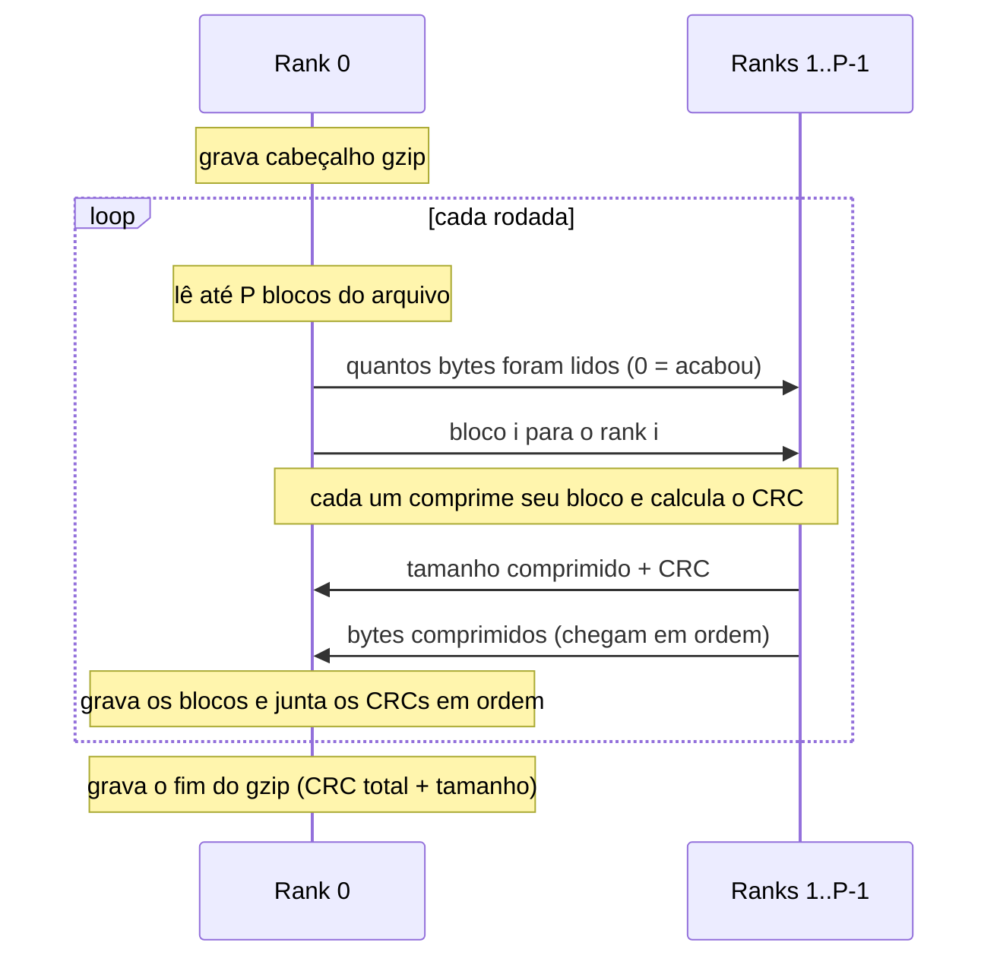

# Arquitetura paralela — troca de mensagens

**Responsável:** Gabriel · **Revisor:** Renan

Rank 0 lê, distribui, recebe e grava. Todos os ranks comprimem.
O arquivo é processado em rodadas de P blocos (1 bloco = 1 MB).

