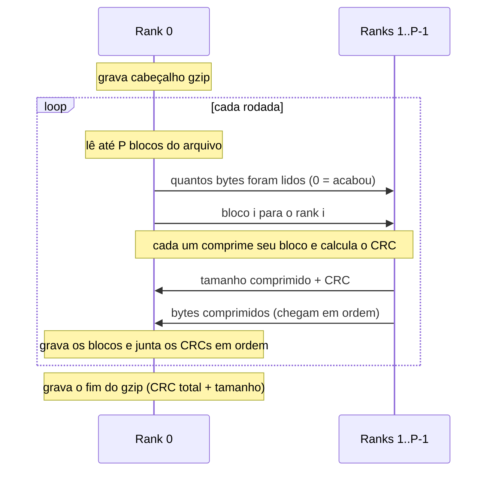

# Arquitetura paralela — troca de mensagens

**Responsável:** Gabriel · **Revisor:** Renan

Rank 0 lê, distribui, recebe e grava. Todos os ranks comprimem.
O arquivo é processado em rodadas de P blocos (1 bloco = 1 MB).

## Funções MPI usadas (em ordem, a cada rodada)

| Passo | Mensagem                          | Função MPI      | De → Para     |
|-------|-----------------------------------|-----------------|---------------|
| 1     | quantos bytes foram lidos         | `MPI_Bcast`     | 0 → todos     |
| 2     | bloco i para o rank i             | `MPI_Scatterv`  | 0 → todos     |
| 3     | tamanho comprimido + CRC          | `MPI_Gather`    | todos → 0     |
| 4     | bytes comprimidos                 | `MPI_Gatherv`   | todos → 0     |

**Regra:** toda função coletiva tem que ser chamada por **todos** os ranks,
na **mesma ordem**. Se um rank pular uma, o programa trava (deadlock).

## Formato do arquivo de saída (.gz)

| Parte              | Tamanho  | Quem escreve | Conteúdo                                  |
|--------------------|----------|--------------|-------------------------------------------|
| Cabeçalho gzip     | 10 bytes | rank 0       | `1f 8b 08 00 00 00 00 00 00 03`           |
| Blocos comprimidos | variável | rank 0       | bloco 0, bloco 1, ... colados em ordem    |
| Bloco final vazio  | 2 bytes  | rank 0       | `03 00` (marca o fim dos dados)           |
| CRC-32             | 4 bytes  | rank 0       | CRCs dos blocos combinados em ordem       |
| Tamanho original   | 4 bytes  | rank 0       | tamanho do arquivo de entrada             |

## Decisões e seus custos
- Cada bloco é comprimido sem "lembrar" do bloco anterior: o `.gz` fica
  um pouco maior que o do `gzip` comum, mas continua válido.
- Cada bloco termina com `Z_SYNC_FLUSH`, para acabar num byte completo
  e poder ser colado no seguinte.
- Só o rank 0 lê e grava arquivos: é mais simples, mas ele vira o gargalo
  quando há muitos processos.