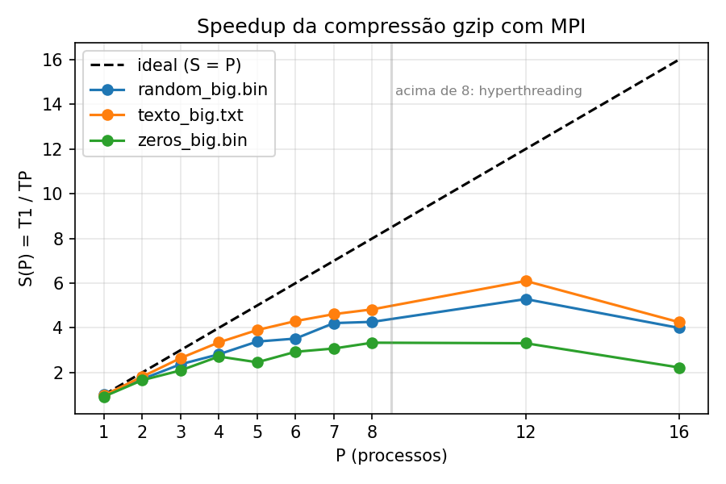

# Testes e desempenho

**Responsáveis:** João Pedro Tomaz (corretude) e José Neto (desempenho)

## Ambiente
- Processador: 11th Gen Intel Core i5-1145G7 @ 2.60GHz, 4 núcleos físicos, 8 threads
- Sistema: CachyOS Linux (Kernel 7.3.3-1-cachyos)
- Compilador / MPI / zlib: `gcc (GCC) 16.2.1 20260810`, `mpirun (Open MPI) 5.0.11`, `zlib-ng-compat 2.3.3`

## 1. Corretude (João Pedro Tomaz)

Critério do professor: o `.gz` passa em `gzip -t` **e** na ida e volta
byte a byte (`gunzip -c saida.gz | cmp - entrada`).

Como rodar: `bash tests/gen_data.sh && bash tests/run_tests.sh`

| Arquivo | Tamanho | Por que testar | Serial | P=1 | P=2 | P=3 | P=4 |
|---|---|---|---|---|---|---|---|
| `vazio.bin` | 0 B | arquivo vazio | PASSOU | PASSOU | PASSOU | PASSOU | PASSOU |
| `um_byte.bin` | 1 B | menor caso possível | PASSOU | PASSOU | PASSOU | PASSOU | PASSOU |
| `texto_pequeno.txt` | ~100 KB | menor que um bloco | PASSOU | PASSOU | PASSOU | PASSOU | PASSOU |
| `bloco_exato.bin` | 1 MB | exatamente 1 bloco | PASSOU | PASSOU | PASSOU | PASSOU | PASSOU |
| `bloco_mais_um.bin` | 1 MB + 1 B | sobra 1 byte | PASSOU | PASSOU | PASSOU | PASSOU | PASSOU |
| `base64_medio.txt` | ~4 MB | várias rodadas | PASSOU | PASSOU | PASSOU | PASSOU | PASSOU |

Resultado: **30 de 30 testes passaram** — tabela completa em `results/tests.csv`.

## 2. Desempenho (José Neto)

S(P) = T1 / TP, com **T1 = versão serial**. Mediana de 5 repetições,
arquivos de 128 MB copiados para o disco do Linux antes de medir.
P = 1 a 8, 12 e 16, com `mpirun --use-hwthread-cpus --bind-to none`.
As duas versões medem o mesmo trecho: ler, comprimir, gravar e fechar
o arquivo (a inicialização do MPI fica de fora). Estas medições foram
feitas em outra máquina (o Ambiente acima é o dos testes de corretude):
AMD Ryzen 7 5700X3D (8 núcleos físicos, 16 threads), Ubuntu 24.04.1 LTS
no WSL2 (Windows 11), gcc 13.3.0, Open MPI 4.1.6 e zlib 1.3.

Como rodar: `bash bench/run_bench.sh && python3 bench/plot.py`

| arquivo | P | T (s, mediana) | S(P) | E(P) |
|---|---|---|---|---|
| random_big.bin | serial | 2.710 | 1.00 | - |
| random_big.bin | 1 | 2.705 | 1.00 | 1.00 |
| random_big.bin | 2 | 1.590 | 1.70 | 0.85 |
| random_big.bin | 3 | 1.144 | 2.37 | 0.79 |
| random_big.bin | 4 | 0.962 | 2.82 | 0.70 |
| random_big.bin | 5 | 0.800 | 3.39 | 0.68 |
| random_big.bin | 6 | 0.770 | 3.52 | 0.59 |
| random_big.bin | 7 | 0.643 | 4.21 | 0.60 |
| random_big.bin | 8 | 0.635 | 4.27 | 0.53 |
| random_big.bin | 12 | 0.513 | 5.29 | 0.44 |
| random_big.bin | 16 | 0.678 | 4.00 | 0.25 |
| texto_big.txt | serial | 3.220 | 1.00 | - |
| texto_big.txt | 1 | 3.290 | 0.98 | 0.98 |
| texto_big.txt | 2 | 1.775 | 1.81 | 0.91 |
| texto_big.txt | 3 | 1.218 | 2.64 | 0.88 |
| texto_big.txt | 4 | 0.961 | 3.35 | 0.84 |
| texto_big.txt | 5 | 0.825 | 3.90 | 0.78 |
| texto_big.txt | 6 | 0.748 | 4.30 | 0.72 |
| texto_big.txt | 7 | 0.698 | 4.61 | 0.66 |
| texto_big.txt | 8 | 0.667 | 4.83 | 0.60 |
| texto_big.txt | 12 | 0.528 | 6.10 | 0.51 |
| texto_big.txt | 16 | 0.757 | 4.25 | 0.27 |
| zeros_big.bin | serial | 0.543 | 1.00 | - |
| zeros_big.bin | 1 | 0.589 | 0.92 | 0.92 |
| zeros_big.bin | 2 | 0.328 | 1.66 | 0.83 |
| zeros_big.bin | 3 | 0.259 | 2.09 | 0.70 |
| zeros_big.bin | 4 | 0.200 | 2.72 | 0.68 |
| zeros_big.bin | 5 | 0.221 | 2.46 | 0.49 |
| zeros_big.bin | 6 | 0.185 | 2.93 | 0.49 |
| zeros_big.bin | 7 | 0.176 | 3.08 | 0.44 |
| zeros_big.bin | 8 | 0.163 | 3.34 | 0.42 |
| zeros_big.bin | 12 | 0.164 | 3.31 | 0.28 |
| zeros_big.bin | 16 | 0.244 | 2.23 | 0.14 |

Entre as 5 repetições, a diferença entre a execução mais rápida e a mais
lenta ficou em até 20% na maioria dos pontos, e com P = 16 foi de 30% a
138%. Com a mediana, uma ou duas execuções mais lentas não puxam o
resultado, mas diferenças pequenas entre valores vizinhos de P ficam
dentro dessa variação.

Também conferimos que o `.gz` gerado com P = 16 para os três arquivos de
128 MB passa no `gzip -t` e na ida e volta com `cmp`.

## 3. Análise (José Neto)
- Com P = 1: a versão MPI fica igual ou um pouco mais lenta que a serial
  (S = 0,98 no texto, 1,00 no aleatório e 0,92 nos zeros). É o custo de
  comprimir em blocos de 1 MB separados e de passar os dados pelas chamadas
  do MPI. Nos zeros a compressão é muito rápida, então esse custo pesa mais.
  O tamanho do `.gz` quase não muda com os blocos (texto: 34.726.162 bytes
  na serial e 34.667.088 na MPI) e é o mesmo para qualquer P.
- Com P = 2: S ficou entre 1,66 e 1,81. Não chega a 2 porque, além de
  comprimir o seu bloco, o rank 0 lê a rodada, distribui os blocos, junta o
  resultado e grava, e nesse tempo o outro processo fica esperando.
- De P = 3 a 8 (até 8 cada processo pode ter um núcleo físico só para ele):
  o speedup continua subindo, mas a eficiência cai (no texto, de 0,88 com
  P = 3 para 0,60 com P = 8). A compressão é dividida entre mais processos,
  enquanto a parte que só o rank 0 faz continua do mesmo tamanho. Nos zeros
  a curva oscila um pouco (P = 5 pior que P = 4), porque os tempos são de
  só 0,2 s e essa diferença fica dentro da variação entre repetições.
- Acima de 8 (hyperthreading): com P = 12 pelo menos 4 núcleos rodam dois
  processos ao mesmo tempo. Mesmo assim o texto (6,10) e o aleatório (5,29)
  melhoraram em relação a P = 8. Na aula 1, as duas threads de um núcleo
  aparecem dividindo a ALU e os caches L1 e L2, e no gráfico de cache miss
  da mesma aula o gzip é o programa que mais fica parado esperando a memória
  (uns 40% do tempo). Nesses intervalos a outra thread usa o núcleo. Nos
  zeros ficou igual (3,34 e 3,31), porque ali a maior parte do tempo já é a
  parte serial. Com P = 16 todos pioram. As 16 threads ficam ocupadas, então
  o rank 0 divide o núcleo com outro processo e ainda disputa a CPU com o
  Windows e o WSL. Como cada rodada espera o processo mais lento, qualquer
  atraso segura todo mundo, e foi com P = 16 que os tempos mais variaram
  entre as repetições (no aleatório, de 0,628 s a 1,121 s).
- Texto × aleatório × zeros: o texto acelerou mais porque é o que mais gasta
  CPU comprimindo (3,22 s na serial) e a saída tem só uns 26% do tamanho da
  entrada. O aleatório quase não comprime (a saída fica do tamanho da
  entrada), então o rank 0 tem que juntar e gravar os 128 MB inteiros. No
  "Amdahl corrigido" da aula 6, essa comunicação age como uma fração serial
  extra (τ = Tcom/T1), e isso ajuda a explicar por que o aleatório acelera
  menos que o texto. Os zeros comprimem muito rápido (0,54 s na serial),
  então sobra pouco trabalho para dividir e o tempo de ler e distribuir os
  128 MB domina.
- Limitação da arquitetura: o rank 0 lê, junta e grava sozinho, e enquanto
  isso os outros esperam. Pela estimativa da aula 2,
  f_paralelo ≈ (1 - 1/S)/(1 - 1/n), com S(8) a fração paralela fica em 0,91
  no texto, 0,88 no aleatório e 0,80 nos zeros. Ou seja, a parte serial (que
  inclui a comunicação) fica em uns 9%, 12% e 20%, e pela lei de Amdahl o
  speedup não passaria de umas 11, 8 e 5 vezes, mesmo com mais núcleos.
  Daria para melhorar fazendo o rank 0 ler a próxima rodada enquanto os
  outros comprimem, ou com cada processo lendo e gravando a sua parte com
  MPI-IO.
